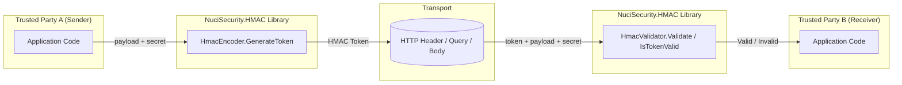
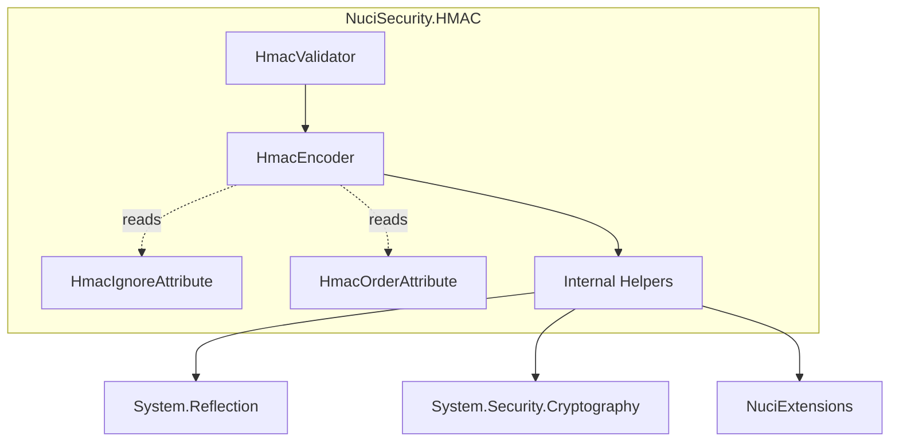
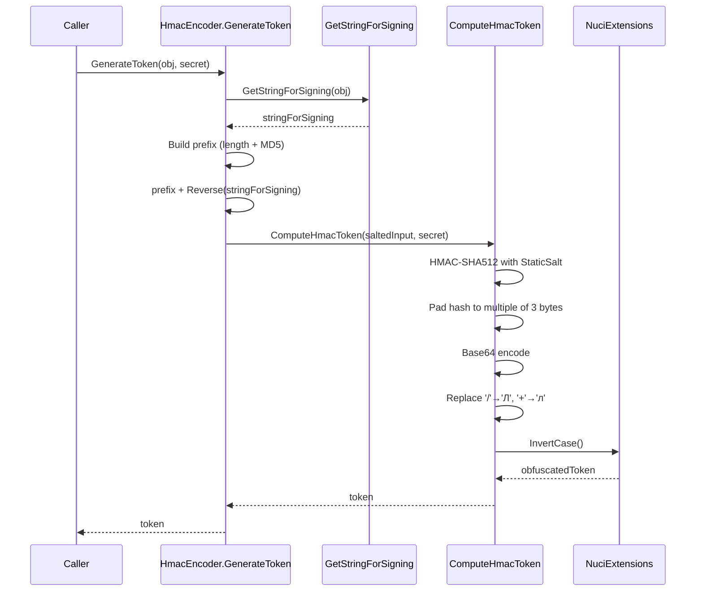
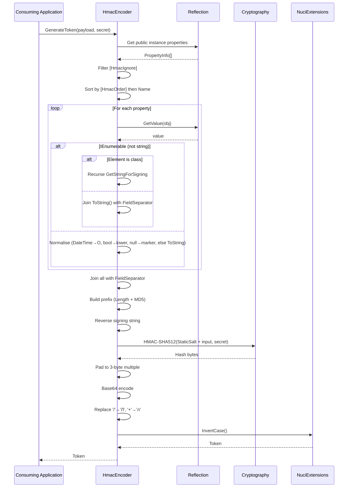
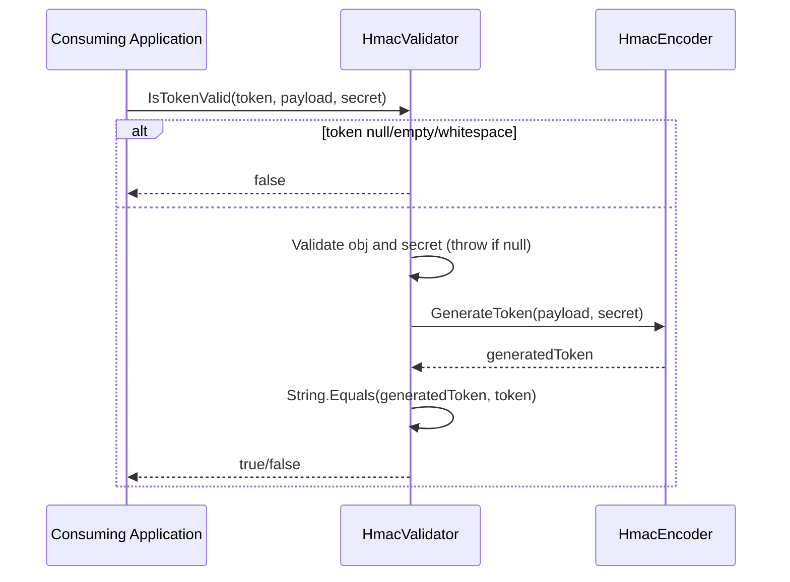
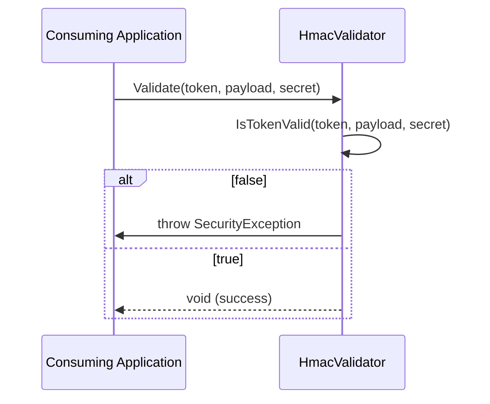
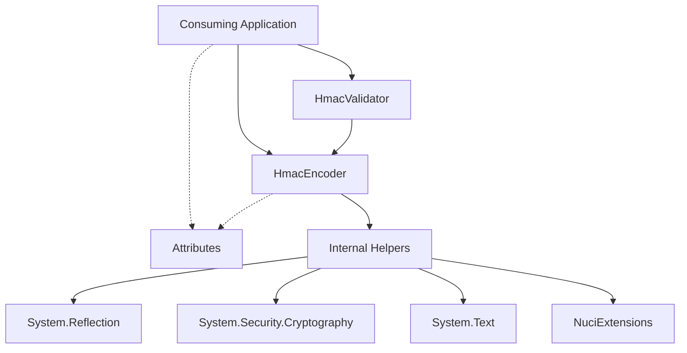

# NuciSecurity.HMAC Architecture

This document describes the current architecture of NuciSecurity.HMAC, a .NET library for generating and validating deterministic HMAC tokens from object instances. The library is distributed as a NuGet package and runs entirely within the consuming application's process.

## 📑 Table of Contents

- [Purpose](#-purpose)
- [System Context](#-system-context)
- [Architectural Style](#-architectural-style)
- [Runtime Flow](#-runtime-flow)
- [Components](#-components)
- [Architectural Areas](#-architectural-areas)
- [Data Architecture](#-data-architecture)
- [Interfaces and Integrations](#-interfaces-and-integrations)
- [Key Flows](#-key-flows)
- [Cross-Cutting Concerns](#-cross-cutting-concerns)
- [Dependency Direction and Rules](#-dependency-direction-and-rules)
- [External Dependencies](#-external-dependencies)
- [Deployment and Operations](#-deployment-and-operations)
- [Compatibility Contracts](#-compatibility-contracts)
- [Testing and Verification](#-testing-and-verification)
- [Design Constraints](#-design-constraints)
- [Extension Points](#-extension-points)
- [Architecture Decisions](#-architecture-decisions)
- [Source Map](#-source-map)
- [Related Documentation](#-related-documentation)

## 🎯 Purpose

NuciSecurity.HMAC provides deterministic HMAC token generation and validation for .NET applications. Its principal responsibility is to compute a cryptographic token from an object's public instance properties (excluding those marked with `[HmacIgnore]`, ordered by `[HmacOrder]` then alphabetically) and a shared secret key, enabling integrity and authenticity verification between trusted parties. The audience is .NET developers integrating HMAC-based signing into APIs, webhooks, callbacks, or DTO anti-tampering scenarios. This document records the current architecture as implemented in the repository.

## 🌐 System Context



The principal external boundaries are:
- **Consuming Application (Sender):** Provides the object instance and shared secret; receives the generated token. Owns the secret and the payload structure.
- **Transport Layer:** Carries the token and payload between parties. The library has no transport dependency; any channel (HTTP header, query parameter, message body) is supported.
- **Consuming Application (Receiver):** Provides the received token, object instance, and shared secret; receives validation result. Owns the secret and the expected payload structure.
- **NuGet Package Manager:** Distribution channel for the library. The library has no runtime dependency on NuGet.

## 🏗️ Architectural Style

NuciSecurity.HMAC follows a **stateless utility library** architectural style. The library exposes only static methods with no internal state, no dependency injection, and no background services. All operations are pure functions of their inputs (object instance, secret key, and optional token). This style ensures thread safety, zero initialisation overhead, and trivial integration into any .NET application (console, ASP.NET Core, worker service, etc.).



The principal architecture boundaries are:
- **Public API Surface:** `HmacEncoder.GenerateToken`, `HmacValidator.IsTokenValid`, `HmacValidator.Validate`, `HmacIgnoreAttribute`, `HmacOrderAttribute`. These are the only types consumers should reference.
- **Internal Implementation:** `GetStringForSigning`, `ComputeHmacToken`, `PadBytes`, `GetMd5Hash`, constants (`StaticSalt`, `FieldSeparator`, `EmptyValue`, `PrefixFormat`, `DefaultOrder`). Not accessible to consumers.
- **Framework Dependencies:** `System.Reflection` (property enumeration), `System.Security.Cryptography` (HMAC-SHA512, MD5), `System.Text` (StringBuilder, Encoding).
- **External Package:** `NuciExtensions` (string `Reverse()` and `InvertCase()` extension methods).

## 🔄 Runtime Flow



The principal runtime sequence for token generation is:
1. **Input validation:** Throw if object or secret is null/whitespace.
2. **String for signing:** Enumerate public instance properties via reflection, filter out `[HmacIgnore]`, sort by `[HmacOrder]` then name, normalise each value (DateTime→"O", bool→lowercase, null→marker, collections→recursive or flattened), join with `FieldSeparator`.
3. **Prefix construction:** Format `|#Length:{len};Checksum:{md5}#|` where length is the signing string length and checksum is its MD5 hash.
4. **Obfuscation:** Reverse the signing string, prepend prefix.
5. **HMAC computation:** Salt with `StaticSalt`, compute HMAC-SHA512, pad hash to multiple of 3 bytes, Base64 encode, substitute Cyrillic characters for `/` and `+`, invert case.
6. **Return token:** Base64-like string without `=` padding.

The principal runtime sequence for token validation is:
1. **Input validation:** Return `false` if expected token is null/empty/whitespace; throw if object or secret is null/whitespace.
2. **Token generation:** Call `HmacEncoder.GenerateToken` with the provided object and secret.
3. **Comparison:** Ordinal string equality between generated and expected token.
4. **Result:** Return `bool` (`IsTokenValid`) or throw `SecurityException` (`Validate`).

## 🧩 Components

| Component | Responsibility | Principal Dependencies | Lifetime or Ownership |
|-----------|----------------|------------------------|-----------------------|
| `HmacEncoder` | Token generation via `GenerateToken<T>`; obsolete `IsTokenValid` delegates to `HmacValidator` | `System.Reflection`, `System.Security.Cryptography`, `System.Text`, `NuciExtensions`, internal helpers | Static class; no lifetime; owned by library |
| `HmacValidator` | Token validation via `IsTokenValid<T>` (bool) and `Validate<T>` (throws `SecurityException`) | `HmacEncoder`, `System.Security` | Static class; no lifetime; owned by library |
| `HmacIgnoreAttribute` | Marks properties to exclude from token computation | `System.Attribute` | Attribute; metadata only; owned by library |
| `HmacOrderAttribute` | Specifies processing order for a property (lower = earlier) | `System.Attribute` | Attribute; metadata only; owned by library |
| `Internal Helpers` (`GetStringForSigning`, `ComputeHmacToken`, `PadBytes`, `GetMd5Hash`, constants) | Core implementation details: property enumeration, value normalisation, HMAC computation, padding, checksum | `System.Reflection`, `System.Security.Cryptography`, `System.Text`, `NuciExtensions` | Private static methods/fields; owned by library |

## 🗂️ Architectural Areas

### Public API

Paths:
- `NuciSecurity.HMAC/HmacEncoder.cs`
- `NuciSecurity.HMAC/HmacValidator.cs`
- `NuciSecurity.HMAC/HmacIgnoreAttribute.cs`
- `NuciSecurity.HMAC/HmacOrderAttribute.cs`

Responsibilities:
- Define the complete public contract for consumers
- Provide token generation, validation, and configuration attributes

Boundary rules:
- No public types beyond the five listed above
- No instance members; all members are static
- No `internal` members exposed to consumers

### Internal Implementation

Paths:
- `NuciSecurity.HMAC/HmacEncoder.cs` (private static members)

Responsibilities:
- Property enumeration and filtering via reflection
- Value normalisation for DateTime, bool, null, collections
- Prefix construction (length + MD5 checksum)
- HMAC-SHA512 computation with static salt
- Byte padding to avoid Base64 `=` padding
- Cyrillic substitution and case inversion for token obfuscation

Boundary rules:
- All members `private static`
- No external visibility
- Pure functions with no side effects

### Unit Tests

Paths:
- `NuciSecurity.HMAC.UnitTests/HmacEncoderTests.cs`
- `NuciSecurity.HMAC.UnitTests/Helpers/*.cs`

Responsibilities:
- Verify deterministic token generation
- Validate attribute behaviour (`[HmacIgnore]`, `[HmacOrder]`)
- Test collection handling (complex and scalar)
- Test validation paths (valid, invalid, null/empty token, null inputs)

Boundary rules:
- Test project references main project via `ProjectReference`
- Uses NUnit 4.x + Moq
- No `InternalsVisibleTo`; tests only exercise public API

## 💾 Data Architecture

```mermaid
flowchart LR
    Input[Input Object] --> Reflect[Reflection Enumeration]
    Reflect --> Filter[Filter [HmacIgnore]]
    Filter --> Sort[Sort by [HmacOrder] then Name]
    Sort --> Normalise[Value Normalisation]
    Normalise --> Join[Join with FieldSeparator]
    Join --> Prefix[Prefix: Length + MD5]
    Prefix --> Reverse[Reverse String]
    Reverse --> Salt[Salt with StaticSalt]
    Salt --> HMAC[HMAC-SHA512]
    HMAC --> Pad[Pad to 3-byte Multiple]
    Pad --> B64[Base64 Encode]
    B64 --> Subst[Cyrillic Substitution]
    Subst --> Invert[Invert Case]
    Invert --> Token[Output Token]
```

| Data or Store | Owner | Representation and Storage | Lifecycle or Consistency |
|---------------|-------|----------------------------|--------------------------|
| Input Object | Caller | Any POCO with public instance properties | Transient; provided per call |
| Shared Secret | Caller | UTF-8 string | Transient; provided per call; never stored |
| Signing String | Internal | `StringBuilder` in memory | Transient; per call |
| MD5 Checksum | Internal | 128-bit hash (hex in prefix) | Transient; per call |
| HMAC Hash | Internal | 512-bit hash (byte array) | Transient; per call |
| Output Token | Caller | Base64-like string (no `=`, Cyrillic `/` `+`, inverted case) | Returned to caller; library retains nothing |
| Static Salt | Library | Constant string `NuciSecurity.HMAC.StaticSalt.{guid}` | Compile-time constant; same across all versions |

The library does not persist any data. All computation is in-memory and per-call. The consuming application controls all storage, retention, and deletion of tokens and signed objects.

## 🔌 Interfaces and Integrations

| Interface or Integration | Direction | Contract | Owner | Failure Semantics |
|--------------------------|-----------|----------|-------|-------------------|
| `HmacEncoder.GenerateToken<T>` | Inbound (caller → library) | `T obj, string sharedSecretKey` → `string token` | `HmacEncoder` | Throws `ArgumentNullException` for null obj/secret |
| `HmacValidator.IsTokenValid<T>` | Inbound (caller → library) | `string expectedToken, T obj, string sharedSecretKey` → `bool` | `HmacValidator` | Returns `false` for null/empty token; throws for null obj/secret |
| `HmacValidator.Validate<T>` | Inbound (caller → library) | `string expectedToken, T obj, string sharedSecretKey` → `void` | `HmacValidator` | Throws `SecurityException` on invalid token; throws `ArgumentNullException` for null obj/secret |
| `[HmacIgnoreAttribute]` | Inbound (metadata) | Applied to property → excluded from signing | `HmacEncoder` (reads via reflection) | Silent exclusion; no error if misapplied |
| `[HmacOrderAttribute]` | Inbound (metadata) | Applied to property → `int Order` | `HmacEncoder` (reads via reflection) | Default order `int.MaxValue` if absent |
| NuGet Package Distribution | Outbound (library → registry) | `.nupkg` with `net10.0` target | Build pipeline | Build fails on compilation/test failure |
| NuciExtensions | Inbound (library → package) | `string.Reverse()`, `string.InvertCase()` | `HmacEncoder` (internal) | Compile-time dependency; runtime failure if missing |

## 🔀 Key Flows

### Token Generation Flow



Ordering invariants:
- Properties with `[HmacOrder]` processed first, ascending by `Order` value
- Remaining properties processed alphabetically by name
- `[HmacIgnore]` properties never included
- Deterministic for identical object graph and secret

### Token Validation Flow





## 🧵 Cross-Cutting Concerns

### Security and Privacy

- **Trust boundary:** The library assumes the shared secret is known only to trusted parties. The secret is never logged, stored, or transmitted by the library.
- **Token integrity:** HMAC-SHA512 provides 256-bit security level (half of 512-bit output). The static salt prevents cross-library token confusion.
- **Input validation:** Null object/secret throws `ArgumentNullException`. Null/empty expected token returns `false` (validation) or throws (generation).
- **No sensitive data exposure:** Tokens contain no plaintext payload data. The prefix includes only length and MD5 checksum of the signing string.
- **Self-hosted responsibility:** The library has no telemetry, update checks, or external communication. The consuming application controls all secrets, logs, and network exposure.

### Error Handling

- **Generation failures:** `ArgumentNullException` for null object or secret. No other exceptions from `GenerateToken`.
- **Validation failures:** `IsTokenValid` returns `false` for invalid/missing token; throws `ArgumentNullException` for null object/secret. `Validate` throws `SecurityException` with fixed message "The HMAC token is not valid." on invalid token; propagates `ArgumentNullException` for null object/secret.
- **Reflection failures:** Property access exceptions propagate (e.g., indexer properties, exceptions in getters). Not wrapped.
- **Cryptographic failures:** `CryptographicException` from HMAC/MD5 would propagate. Not wrapped.

### Configuration

| Configuration Area | Source | Responsibility | Override or Secret Policy |
|--------------------|--------|----------------|---------------------------|
| Target Framework | `NuciSecurity.HMAC.csproj` | `net10.0` | Fixed per release |
| NuciExtensions Version | `NuciSecurity.HMAC.csproj` | `5.3.1` | Updated via NuGet |
| Test Framework | `NuciSecurity.HMAC.UnitTests.csproj` | NUnit 4.5.1, Moq 4.20.72 | Updated via NuGet |
| Shared Secret | Caller at runtime | HMAC key | Never hardcoded; caller responsibility |

No configuration files, environment variables, or runtime configuration sources are used by the library.

### Concurrency and Resource Use

- **Thread safety:** All public methods are stateless and thread-safe. No shared mutable state.
- **Memory allocation:** `StringBuilder` for signing string, byte arrays for HMAC, Base64 string for token. All per-call, eligible for GC immediately.
- **No pooling, caching, or background threads.**
- **Capacity limits:** Limited by input object graph size and available memory. No explicit bounds enforced.

## 🧭 Dependency Direction and Rules



The principal dependency rules are:
- **Public API depends on nothing external** except `System.*` and `NuciExtensions`.
- **Internal implementation depends only on** `System.Reflection`, `System.Security.Cryptography`, `System.Text`, and `NuciExtensions`.
- **No circular dependencies.** Validator calls Encoder; Encoder does not call Validator.
- **Attributes are metadata only**; no code dependencies on them.
- **Test project depends on main project** via `ProjectReference`; main project has no dependency on tests.
- **Prohibited:** Runtime dependencies on ASP.NET Core, HTTP, logging, DI, or any framework beyond .NET BCL and NuciExtensions.

## 📦 External Dependencies

| Dependency | Responsibility | Integration Boundary | Architectural Consequence |
|------------|----------------|----------------------|---------------------------|
| `NuciExtensions` (5.3.1) | String `Reverse()` and `InvertCase()` extension methods | `HmacEncoder` internal helpers | Compile-time and runtime dependency; single-purpose; same author; low risk |
| `System.Reflection` | Property enumeration, attribute reading, value access | `GetStringForSigning` | BCL; stable; reflection overhead per call |
| `System.Security.Cryptography` | HMAC-SHA512, MD5 | `ComputeHmacToken`, `GetMd5Hash` | BCL; FIPS-compliant on supported platforms |
| `System.Text` | `StringBuilder`, `Encoding.UTF8` | Signing string construction, byte encoding | BCL; negligible overhead |
| `Microsoft.NET.Test.Sdk` / `NUnit` / `Moq` / `NUnit3TestAdapter` | Unit test execution | Test project only | No production impact |

## 🚀 Deployment and Operations

| Concern | Current Design | Architectural Consequence |
|---------|----------------|---------------------------|
| Deployment Model | NuGet package (`.nupkg`) | Consumers add via `dotnet add package`; no installation, no service |
| Process Topology | In-process library | Zero operational overhead; runs in caller's process |
| Persistent State | None | No database, files, caches, or state to manage |
| Scaling | Stateless, per-call | Scales with caller; no bottlenecks in library |
| Startup/Shutdown | No initialisation or cleanup | Instant availability; no warm-up |
| Operator-Visible Outputs | None | No logs, metrics, health checks, or diagnostics emitted |
| Versioning | Semantic versioning in `.csproj` | `4.1.3` current; breaking changes require major version |
| Target Framework | `net10.0` | Requires .NET 10.0 runtime on consumer |

## 🛡️ Compatibility Contracts

| Contract | Owner | Invariant | Verification | Change Policy |
|----------|-------|-----------|--------------|---------------|
| `HmacEncoder.GenerateToken<T>` signature | `HmacEncoder` | Same inputs → same token (determinism) | Unit tests: `HmacEncoderTests` | Non-breaking only; new overloads permitted |
| `HmacValidator.IsTokenValid<T>` signature | `HmacValidator` | Returns `true` iff token matches generated | Unit tests | Non-breaking only |
| `HmacValidator.Validate<T>` signature | `HmacValidator` | Throws `SecurityException` iff invalid | Unit tests | Non-breaking only |
| `[HmacIgnoreAttribute]` behaviour | `HmacEncoder` | Marked properties never affect token | Unit tests | Behaviour fixed; attribute cannot change |
| `[HmacOrderAttribute]` behaviour | `HmacEncoder` | Lower `Order` = earlier processing | Unit tests | Behaviour fixed; attribute cannot change |
| Token format | `HmacEncoder` | Base64-like, no `=`, Cyrillic `/` `+`, inverted case | Unit tests (implicit) | Format change = breaking; requires major version |
| Target Framework | Project | `net10.0` | Build | Upgrade only with major version |

## ✅ Testing and Verification

The test project `NuciSecurity.HMAC.UnitTests` verifies:
- Deterministic token generation for identical inputs
- Attribute-driven exclusion (`[HmacIgnore]`) and ordering (`[HmacOrder]`)
- Collection handling (complex object recursion, scalar flattening)
- Value normalisation (DateTime "O", bool lowercase, null marker)
- Validation paths: valid token, invalid token, null/empty token, null object, null secret
- Obsolete `HmacEncoder.IsTokenValid` delegation to `HmacValidator`

Execute the principal automated verification with:

```bash
dotnet test --no-build --verbosity normal
```

Build verification (compilation only):

```bash
dotnet build --no-restore
```

Material coverage gaps:
- No integration tests (library has no external integrations)
- No performance/benchmark tests
- No FIPS compliance tests
- No fuzzing or property-based tests

## ⚠️ Design Constraints

- **Statelessness:** No instance state, no caching, no background work. Limits extensibility but guarantees thread safety and zero overhead.
- **Reflection-based:** Property enumeration uses `BindingFlags.Public | BindingFlags.Instance`. Excludes fields, private properties, static properties, indexers. Cannot be configured.
- **Fixed normalisation:** DateTime→"O", bool→"true"/"false", null→marker, collections→recursive or flattened. No custom formatters.
- **Fixed cryptography:** HMAC-SHA512 with static salt. No algorithm agility.
- **Fixed obfuscation:** Reverse + Cyrillic substitution + case inversion. Not configurable.
- **No padding:** Base64 output padded to 3-byte multiple to avoid `=`. Token length varies with input.
- **Exact string comparison:** Validation uses ordinal equality. No constant-time comparison (acceptable for HMAC verification where timing reveals nothing about secret).
- **Single target framework:** `net10.0` only. No multi-targeting.

## 🔧 Extension Points

### Custom Value Formatting

Not supported. The library uses fixed normalisation for DateTime, bool, null, and `ToString()` for all other types. To customise, the caller must pre-format values into string properties.

### Additional Attributes

Not supported. Only `[HmacIgnore]` and `[HmacOrder]` are recognised. Adding new attributes requires library modification.

### Alternative Hash Algorithms

Not supported. HMAC-SHA512 is hardcoded. Changing requires library modification and major version bump.

## 📝 Architecture Decisions

| Decision | Rationale | Consequence | Record |
|----------|-----------|-------------|--------|
| Static methods only | Stateless, thread-safe, no DI, trivial integration | No instance configuration, no polymorphism | Documented here |
| Reflection-based property enumeration | Works with any POCO, no interfaces, no code generation | Reflection overhead per call; excludes non-public members | Documented here |
| Attributes for configuration | Declarative, discoverable, compile-time checked | Limited to two behaviours (ignore, order) | Documented here |
| HMAC-SHA512 with static salt | Strong primitive; salt prevents cross-library confusion | No algorithm agility; fixed security level | Documented here |
| String reversal + case inversion + Cyrillic substitution | Defense-in-depth obfuscation; avoids URL encoding issues | Token not human-readable; fixed transform | Documented here |
| MD5 in prefix (checksum only) | Fast integrity check for signing string | MD5 not security-critical here; collision resistance not required | Documented here |
| No `=` padding in token | Cleaner tokens; no padding ambiguity | Variable token length; requires 3-byte hash padding | Documented here |
| Exact string comparison for validation | Simple, deterministic; timing safe for HMAC | No constant-time comparison needed | Documented here |
| Single target framework (net10.0) | Simplifies build, testing, distribution | Consumers must use .NET 10.0+ | Documented here |

## 🗺️ Source Map

| Area | Path |
|------|------|
| Public API - Encoder | `NuciSecurity.HMAC/HmacEncoder.cs` |
| Public API - Validator | `NuciSecurity.HMAC/HmacValidator.cs` |
| Public API - Attributes | `NuciSecurity.HMAC/HmacIgnoreAttribute.cs`, `NuciSecurity.HMAC/HmacOrderAttribute.cs` |
| Internal Implementation | `NuciSecurity.HMAC/HmacEncoder.cs` (private static members) |
| Unit Tests | `NuciSecurity.HMAC.UnitTests/HmacEncoderTests.cs` |
| Test Helpers | `NuciSecurity.HMAC.UnitTests/Helpers/*.cs` |
| Project Configuration | `NuciSecurity.HMAC/NuciSecurity.HMAC.csproj` |
| Test Project Configuration | `NuciSecurity.HMAC.UnitTests/NuciSecurity.HMAC.UnitTests.csproj` |
| Solution | `NuciSecurity.HMAC.slnx` |
| CI/CD | `.github/workflows/dotnet.yml` |

## 📚 Related Documentation

- [README.md](./README.md) — Project overview, installation, quick start, API reference
- [CONTRIBUTING.md](./CONTRIBUTING.md) — Contribution guidelines, development setup, testing
- [PRIVACY.md](./PRIVACY.md) — Data handling, self-hosted deployment, security
- [docs/security.md](./docs/security.md) — Threat model, cryptographic design, security boundaries
- [docs/architecture.md](./docs/architecture.md) — Implementation-level architecture detail (this document's companion)
- [LICENSE](./LICENSE) — GNU GPL v3.0 or later